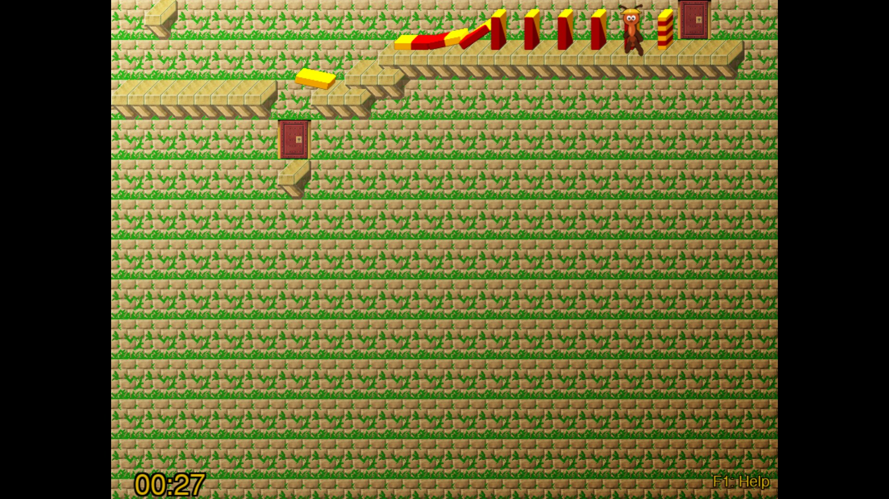
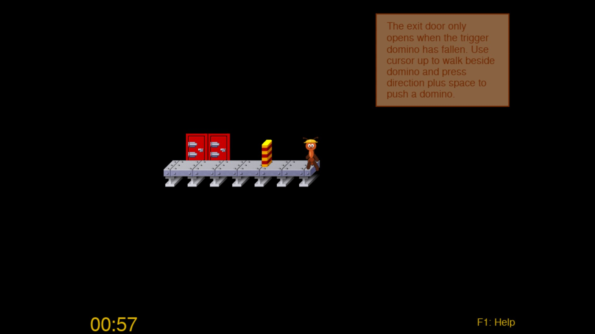
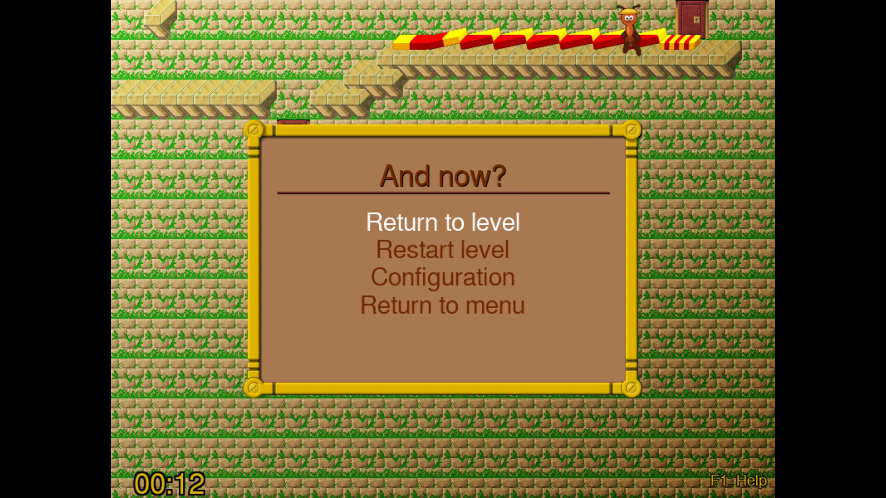

# Domino-Chain for LG webOS

[Domino-Chain](https://domino-chain.gitlab.io), the open-source puzzle game in which a row of dominoes must topple with one push, built as a native webOS app (`com.pulp.dominochain`). It ships with the game's own level sets: the tutorial and the A&V levels. The figure is redrawn as an ant in a hard hat. It was developed and tested on an LG C1 running webOS 6.5.3.

## Screenshots

Taken on the LG C1 at 1080p.

| | |
|---|---|
|  |  |
| A level of the A&V set | A tutorial level |
|  | |
| The level menu, opened with the remote's Back button | |

## Requirements

- **An ARMv8 CPU**, as in TVs with a 64-bit kernel such as the LG C1. The code is built for the Cortex-A55 in 32-bit mode, so it doesn't run on older ARMv7-only TVs.
- **Root is not needed.** It installs from the Homebrew Channel or with `ares-install` in Developer Mode.

## Playing

**Controls.**

- **Remote:**
  - the arrows walk, climb ladders and go through doors;
  - OK picks up, puts down and pushes a domino, and chooses in the menus;
  - Back opens the level's menu and goes back in the menus;
  - the red button shows the level's help.
- **Game controller:**
  - the D-pad and the left stick move;
  - Cross/A is OK;
  - Circle/B and Options/Start are Back;
  - Triangle/Y shows the help.
- **USB keyboard:** as on a PC: the arrows, Space, Escape and F1.

When you press Home, the music stops and the level waits in its menu, with the clock stopped, until you come back.

**Progress.** The levels solved and the profiles are kept in the app folder's `home/`. They survive updating the app, but uninstalling it deletes them.

**The Original level set** holds the levels of Pushover (1992), the game Domino-Chain remakes. It needs that game's level files, which are not included. Copy every `P*.SCR` file from your copy of Pushover into this folder on the TV (over SSH, as root or in Developer Mode):

```
/media/developer/apps/usr/palm/applications/com.pulp.dominochain/home/.local/share/domino-chain/original/
```

**The figure.** Domino-Chain's figure is a stick figure. This port draws an ant over each of its animation frames. Each pose and its timing stay the same, so the ant walks, climbs, carries, pushes, yawns, cheers and falls as the stick figure does. `tools/ant/make.py` draws it into `art/figure.png`, which `package.sh` ships in place of the stick figure. To play with a different figure, put a `figure.png` (same layout, 130 pixels wide) into the app folder's `home/.local/share/domino-chain/`; the game uses it instead.

## How it works

- **Game:** upstream Domino-Chain (1.2~dev) at commit `16826d3e`, with `patches/domino-chain-webos.patch`. `build.sh` clones it into `dc-src/` and applies the patch. The patch:
  - **`webos.cpp`, `webos.h` (new):**
    - the app folder becomes the working directory and its `home/` the home folder;
    - the log goes to `/tmp/domino-chain.log`, with a backtrace on a crash;
    - an event filter turns the remote's Back and red buttons and the game controller into keys;
    - the filter also notices Home and pauses the sound.
  - **`screen.cpp`:** draws through the GPU. The game updates parts of the screen, and a GPU renderer keeps no picture between frames. So the picture lives in a texture: each update changes parts of it, and every frame shows all of it, scaled to the screen.
  - **`main.cpp`:**
    - skips the app manager's JSON launch parameters (the game took them for a level file);
    - opens the level's menu when the game goes into the background;
    - logs why the game ends.
  - **`figure.cpp`:** OK (Return) and the game controller act like Space.
  - **`graphicsn.cpp`, `tools.cpp`:** `std::filesystem` instead of Boost's.
  - **`window.cpp`:** fixes a bug: the Original level set's description showed a literal `%s` where the folder belongs. This fix isn't specific to webOS.
- **`main` is the `domino-chain` binary itself**, as the luna bus identifies an app by the executable named in `main`.
- **Libraries:**
  - webosbrew's [SDL 2.30.12 webOS port](https://github.com/webosbrew/SDL-webOS) (release `2.30.12-webos.1`);
  - SDL2_mixer 2.8.0 (Ogg Vorbis through stb_vorbis);
  - SDL2_ttf 2.22.0;
  - the toolchain's libstdc++, shipped in `lib/` and found through the `$ORIGIN/lib` rpath;
  - Lua 5.4.7 and FriBidi 1.0.16, linked in;
  - libpng, zlib and FreeType from the TV.
- **Data:**
  - the game's images, sounds, themes, levels and translations, as its Makefile installs them;
  - `dominoes.png`, which the game's build renders with POV-Ray, taken from Debian's `domino-chain` 1.1 package (the same scene);
  - GNU FreeFont's FreeSans, the game's font.

## Build

On an x86-64 Linux machine with git, curl, make, unzip, binutils, gettext and Python 3:

```sh
./build-deps.sh  # first run: fetches the openlgtv toolchain (2026.08-webos); builds the libraries into prefix/
./build.sh       # first run: clones Domino-Chain and applies the patch; builds build/domino-chain
./package.sh     # writes output/com.pulp.dominochain_<version>_all.ipk and the Homebrew Channel manifest
```

`package.sh` checks that every symbol the game needs is defined by a library on the TV, given a copy of the TV's libraries: run `tools/fetch-tv-libs.sh root@<tv address>` once. Without that copy, the check is skipped.

To redraw the ant (Python 3 with numpy, SciPy, Pillow and pycairo): `tools/ant/make.py`, which reads the stick figure from `dc-src/` (or `$DC_SRC`) and writes `art/figure.png`.

To install a build by hand as root on the TV:

```sh
luna-send -i -f luna://com.webos.appInstallService/dev/install \
  '{"id":"com.pulp.dominochain","ipkUrl":"/tmp/com.pulp.dominochain_0.2.0_all.ipk","subscribe":true}'
```

## License

Domino-Chain, the patch, the scripts and the ant are GPL-3.0-or-later; see `LICENSE`. Domino-Chain's authors are listed in its `AUTHORS` file, which the app ships.

Licenses of the bundled parts:

- SDL, SDL2_mixer and SDL2_ttf: zlib license;
- Lua: MIT license;
- FriBidi: LGPL-2.1-or-later;
- FreeSans: GPL-3.0-or-later with the font exception;
- libstdc++: GPL-3.0 with the GCC Runtime Library Exception.

Pushover belongs to its rights holders. Neither this port nor Domino-Chain is affiliated with them, and none of Pushover's data is included.
